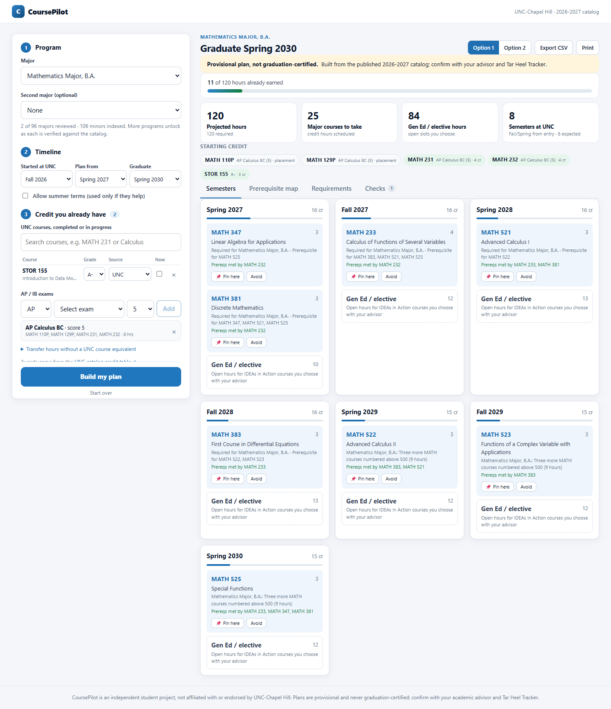
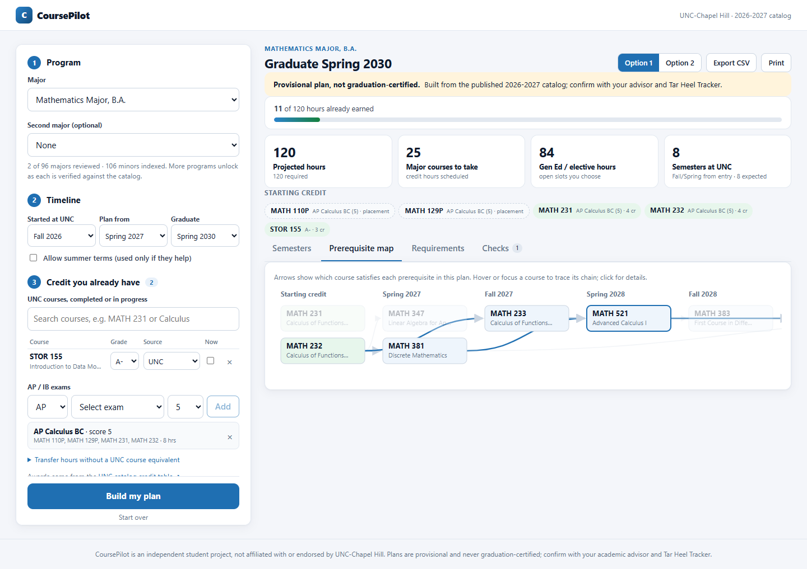
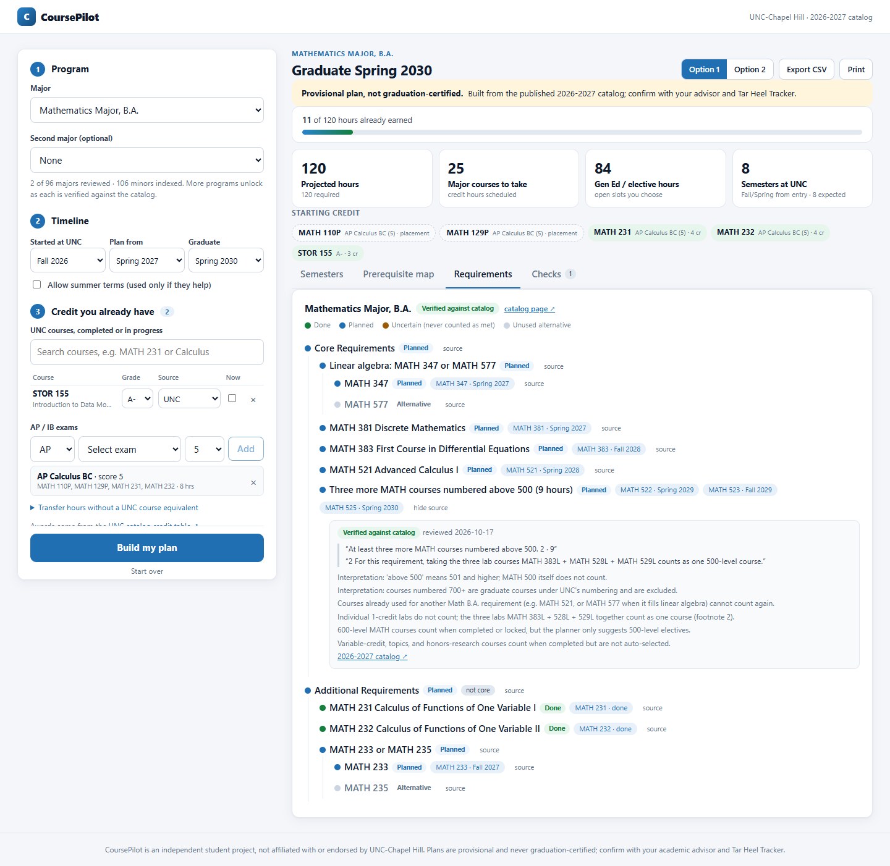
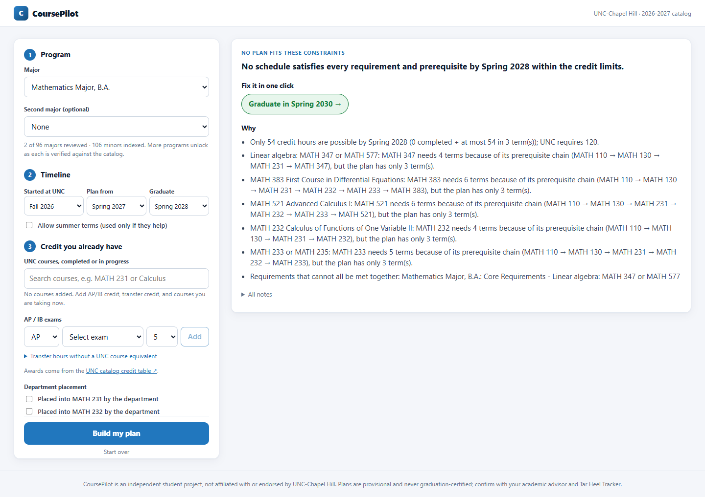
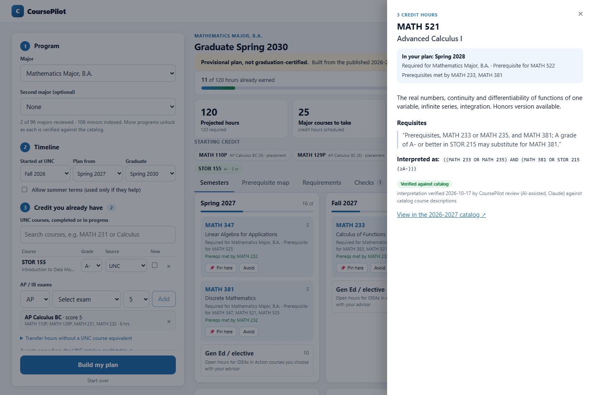
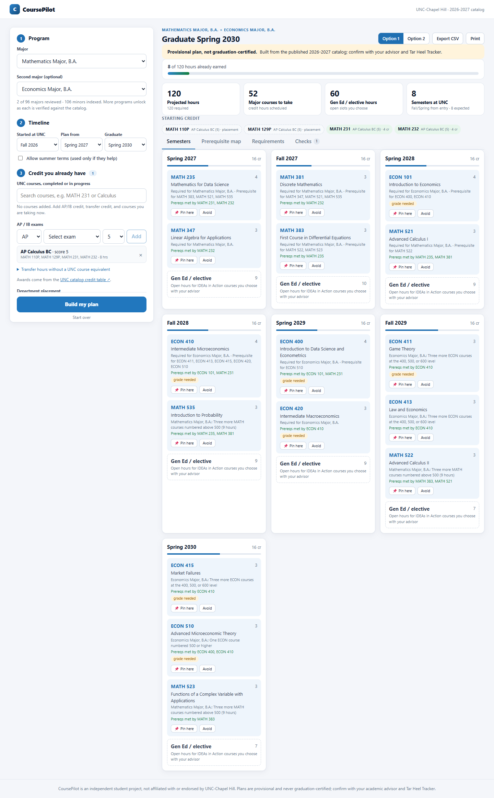
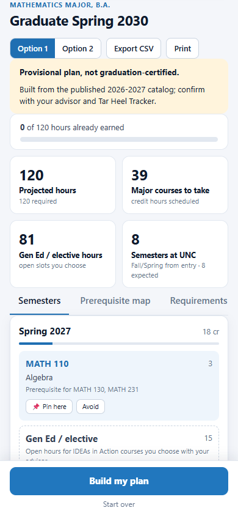
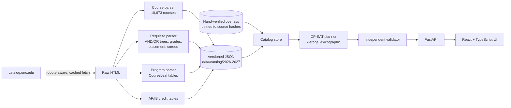

# CoursePilot

**Semester-by-semester degree planning for UNC-Chapel Hill, built on the real catalog and a constraint solver.**

A student picks a major (or a double major), enters the credit they already have (UNC courses, AP/IB scores,
transfer hours) and a graduation term. CoursePilot returns a complete plan to graduation that respects every
prerequisite chain, credit limit and modeled degree rule. When a goal is impossible, it explains *why* and offers
fixes it has already verified.



> **Provisional by design.** CoursePilot is an independent student project, not an official UNC degree audit.
> Every plan is labeled provisional and never "graduation-certified". Verified catalog facts and uncertain
> interpretations are always shown separately.

---

## What it does

| | |
|---|---|
| **Real data** | All **10,673 courses** across 156 subjects and **202 programs** from the official 2026–27 catalog, plus the catalog's **AP/IB credit tables** (140 awards). Every requirement links to the catalog text it came from. |
| **Real planner** | Google **OR-Tools CP-SAT** schedules every course into a specific term. It pulls in missing prerequisites automatically, keeps terms at 12–18 hours, reaches 120 hours, and applies the B.A. 45-hour subject cap. Plans come back in 1–3 s. |
| **Two verified majors** | **Mathematics B.A.** and **Economics B.A.** are hand-verified against the catalog, alone or as a **double major**. The double major enforces UNC's rule that more than half of each core must be exclusive to it. |
| **Explains itself** | Each course shows why it's in the plan, which courses satisfy its prerequisites, and any grade it depends on ("needs C- or better in MATH 231"). An interactive **prerequisite map** traces chains across semesters. |
| **Honest about infeasibility** | "Graduate in 3 semesters" returns the binding reasons (hour capacity, the exact prerequisite chain) and **one-click fixes** that were re-solved and confirmed to work. |
| **Editable** | Pin a course to a term or avoid it, and the solver re-plans around your choice. Two alternative plans, CSV export, print. |

### 60-second demo

1. Open the app. **Mathematics B.A.** is preselected.
2. Under *AP / IB exams*, choose **AP Calculus BC, score 5**. The catalog award (MATH 231 + 232, 8 hrs) appears before you add it.
3. Click **Build my plan**. MATH 231/232 disappear from the plan, and the remaining major is spread across seven semesters.
4. Open **Prerequisite map** and hover **MATH 521** to see its chain light up.
5. In **Requirements**, click *source* on "Three more MATH courses numbered above 500" to see the verbatim catalog text and each interpretation note.
6. Click **Avoid** on MATH 347. The planner switches to MATH 577 and re-orders its prerequisites.
7. Set *Graduate* to **Spring 2028**. You get a clear explanation and a **"Graduate in …"** button that fixes it.
8. Add **Economics B.A.** as a second major for a full double-major plan.

## Screenshots

| Prerequisite map | Requirements with sources |
|---|---|
|  |  |
| **Infeasible goal → one-click fix** | **Course details in plan context** |
|  |  |
| **Math + Economics double major** | **Mobile** |
|  |  |

## How it works



**Catalog pipeline** (`backend/prereqpath/catalog/`). A polite fetcher honors robots.txt, never touches
`/archives/`, rate-limits and caches. The parsers read the catalog's structured markup: course blocks, and requirement
tables whose CSS classes mark OR rows and group headers. The requisite parser turns prose such as *"MATH 233 or
MATH 235, and MATH 381; A grade of A- or better in STOR 215 may substitute for MATH 381"* into a boolean tree with
minimum grades. Text it can't interpret becomes an explicit `unparsed` condition and is never dropped. **81% of
courses with requisites parse fully**, and the rest are labeled.

**Verification model** (`data/verified/`). Each verified requirement keeps its source URL, catalog year, verbatim
source quote and interpretation notes. The overlay is pinned to a SHA-256 of the exact catalog text. If UNC edits the
page, the program automatically drops to `needs_reverification`. Status is always one of `verified`, `parsed`,
`uncertain` or `needs_reverification`.

**Solver** (`backend/prereqpath/planner/engine.py`).

- Variables: `x[course, term]` booleans, plus usage variables `u[requirement, course]`.
- Constraints:
  - Prerequisite trees become reified implications: a course can be taken in term *t* only if its tree holds for courses done before *t*, or in *t* for corequisites.
  - A course satisfies at most one requirement per program.
  - The cross-program core-exclusivity rule (strictly more than half of each core's courses and hours).
  - Per-term credit bounds, 120 total hours, the B.A. subject cap, locks, exclusions and mutually exclusive courses.
- Objective, solved in two stages:
  1. Proven-minimal coursework.
  2. Schedule quality: per-term load cap, even spread `|n·load − total|`, no summers unless needed, core chains early, and courses with fully understood prerequisites first.
- Determinism: interleaved parallel search on a deterministic time budget, so the same request gives the same plan.
- Every solution is re-checked by a separate pure-Python validator before it is returned.

**Infeasibility diagnosis.** The diagnosis combines three sources:

- an unsatisfiable core over assumption literals;
- a credit-capacity check;
- a longest-prerequisite-chain analysis that respects OR-alternatives;
- "what-if" re-solves under a time budget: a later graduation term, summers, removing locks, or department placement.

## Technical decisions

- **Constraint programming instead of search heuristics.** The previous prototype enumerated every subset of courses per term and became unusable past ~20 courses. CP-SAT handles a full double major in about a second and *proves* the coursework is minimal.
- **Fail visibly, not closed.** The old design refused to plan until a 13-category human sign-off existed for each program, so it never produced a plan. Now an uncertain requirement is flagged where it occurs and never counted as met, and the rest of the plan is still produced.
- **Grades are contingencies, not blockers.** A future grade is unknown, so a minimum-grade prerequisite on a planned course becomes a stated condition on that course rather than a refusal.
- **Conservative interpretations, written down.** Example: AP placement credit "MATH 110P" is applied only where a prerequisite lists it. "Numbered above 500" excludes 700-level graduate courses. Each interpretation note is shown in the UI.
- **No AI-invented requirements.** "AI" here means optimization and search over catalog-derived rules. Nothing about requirements is generated by a language model.

## Run it locally

Requirements: Python 3.11+ and Node 18+.

```bash
python -m venv .venv
.venv/Scripts/pip install -e "backend[dev]"        # macOS/Linux: .venv/bin/pip
cd frontend && npm install && npm run build && cd ..
cd backend && ../.venv/Scripts/python -m uvicorn prereqpath.api:app --port 8000
```

Open <http://127.0.0.1:8000>. For UI development, keep the API running and use `npm run dev` in `frontend/`
(Vite on :5173, proxying `/api`).

**Docker:** `docker build -t coursepilot . && docker run -p 8000:8000 coursepilot`
**Deploying:** see [DEPLOY.md](DEPLOY.md) (Render blueprint included).

## Tests

| Suite | Command | Count |
|---|---|---|
| Backend: parser, data, planner, API, double major | `cd backend && ../.venv/Scripts/python -m pytest` | 83 tests |
| Browser end-to-end (real Chrome, running app) | `cd frontend && npm run e2e` | 15 checks |
| Type check | `cd frontend && npm run typecheck` | — |

Planner tests run on the real catalog and re-validate every plan independently. They cover prerequisite order,
retakes, AP/IB credit, cross-listings, honors codes, locks, infeasibility explanations and fixes, randomized
transcripts, and reproducibility across processes. The browser suite covers the main journey, editing, infeasible
fixes, the double major, an API outage, and mobile layout.

## Data coverage

| | |
|---|---|
| Courses (all subjects) | 10,673, with credits, IDEAs attributes and cross-listings |
| Requisites fully parsed | 81.3% of courses that have requisites; the rest are labeled `partial`/`unparsed` |
| Programs discovered | 202 (96 major listings including tracks/concentrations, 106 minors) |
| Programs verified and plannable | Mathematics B.A., Economics B.A. |
| Course requisites hand-verified | 77 (every course those two planners rely on most) |
| AP/IB credit awards | 140 |

Rebuild the data with `python -m prereqpath.catalog.build courses|programs|exams|report`.

## Limitations

- Only two majors are plannable today. The other programs are listed as "not yet reviewed", and minors aren't plannable yet.
- **General Education** (IDEAs in Action) is reserved as labeled placeholder hours, not assigned to specific courses. B.A. Supplemental Gen Ed isn't modeled.
- **Course offering terms** aren't modeled: every course is assumed to be offered every Fall and Spring.
- GPA rules depend on future grades and are reported, not enforced.
- Students who entered before Fall 2026 get 2026–27 requirements with a warning. Archived catalogs must be obtained legitimately; `/archives/` is disallowed by robots.txt and never crawled.
- "Verified" means an AI-assisted review against the published catalog text, recorded with notes. It is not a review by UNC.

## Roadmap

1. **More programs:** generic parsing of all 202 program pages with per-program coverage scores, then verify Computer Science B.S., Business Administration B.S.B.A., Biology B.S. and Psychology B.A.; add minors.
2. **Gen Ed assignment:** use the IDEAs attributes already collected to fill placeholder hours with real course options under the double-counting rules.
3. **Offering patterns:** learn Fall/Spring/Summer availability from UNC's public historical course record.
4. **Accounts and saved plans,** plus "what changed" diffs when the catalog updates.
5. **Natural-language edits** ("lighter spring junior year", "study abroad fall 2028"), translated into solver constraints and never into new requirements.

---

*CoursePilot is not affiliated with or endorsed by UNC-Chapel Hill. The pre-rebuild prototype (v0.7–v2.9) is
preserved on the `backup/v29-prototype` branch.*
